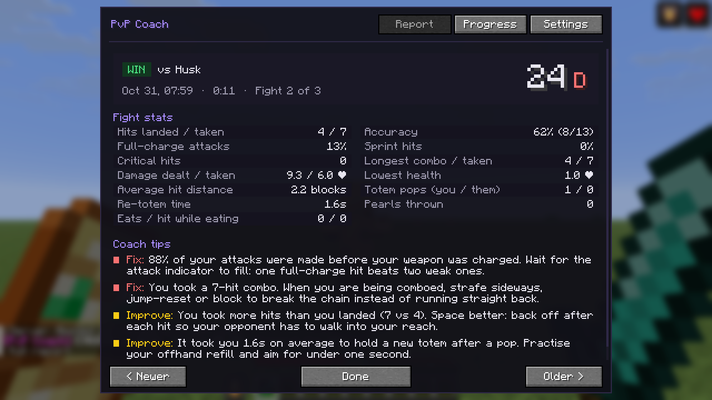
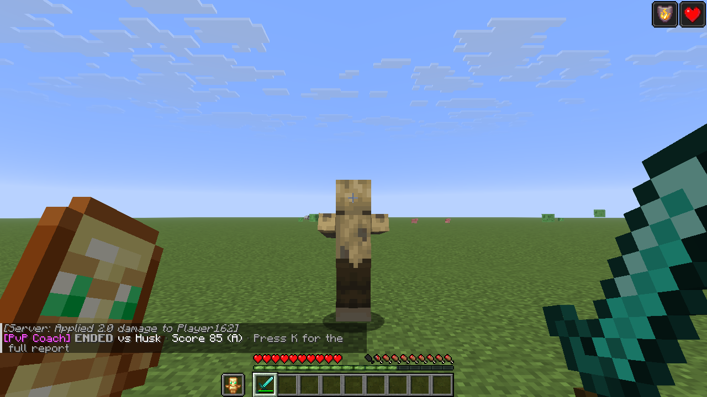
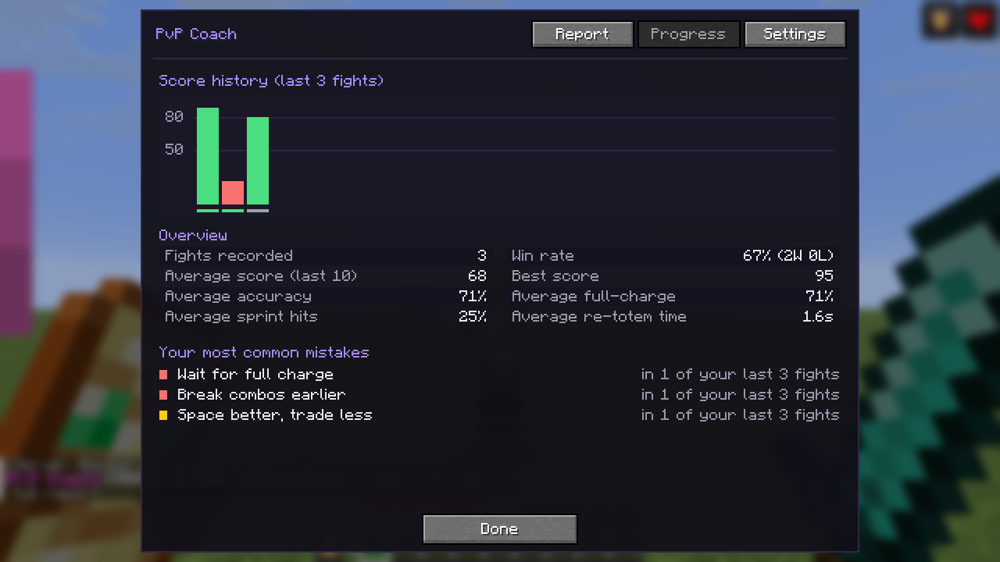
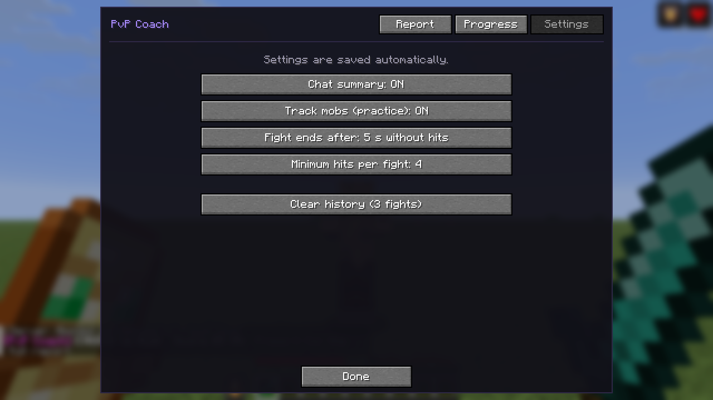

<h1 align="center">🎯 PvP Coach</h1>

<p align="center">
  <b>Your personal PvP trainer for Minecraft 26.1 – 26.3, on Fabric and NeoForge.</b><br>
  PvP Coach watches your fights, finds your mistakes and tells you after every fight what to fix next.
</p>

<p align="center">
  
  
  
  
  
</p>

<p align="center">
  
</p>

Most PvP mods show you numbers *while* you fight. PvP Coach helps you get better *after* the fight: it
measures how you fought, compares it to good habits and gives you a score from 0 to 100 plus concrete tips
in plain English.

## Features

- **Automatic fight detection.** A fight starts when you hit another player or they hit you, and ends when
  someone dies or nobody lands a hit for a few seconds. Nothing to start or stop.
- **Mistake detection.** PvP Coach notices:
  - attacks made before your weapon was charged
  - swings that hit nothing
  - hits without sprint knockback (missed W-taps / sprint resets)
  - long combos you took without breaking them
  - trading more hits than you land
  - slow or missing totem refills after a pop
  - getting hit while eating
  - carrying a shield and never raising it
  - fighting too close instead of using your reach
- **Score and grade.** Every fight gets a score (0–100) and a grade from S to D.
- **Chat summary.** When a fight ends you get one line in chat: result, score and the most important tip.
- **Full report.** Press **K** for all stats and tips of the fight, and browse your older fights.
- **Progress page.** A score chart of your last 30 fights, win rate, trends, and your most common mistakes.
- **Practice mode.** Turn on *Track mobs* to train against mobs in singleplayer.
- **Client-side only.** Works on any server. PvP Coach never presses a key or clicks for you, and it only
  uses information your client already has, so it is not a cheat.

## Screenshots

<p align="center">
  
  <br><sub>The summary in chat right after a fight.</sub>
</p>

<p align="center">
  
  
</p>

## How it measures

| What | How |
|---|---|
| Hits landed / taken | The server's damage events, which name both the victim and the attacker. These are the hits the server actually counted. |
| Charge, sprint, crit, distance | Read from your player at the moment you send the attack. A hit counts as fully charged from 90 %, like in vanilla. |
| Misses | Left clicks that swing at nothing. |
| Totem pops | The totem animation event, for you and your opponent. Re-totem time runs until you hold a new totem. |
| Damage | Health changes of you and your opponent. Some servers hide other players' health, so damage dealt is an estimate. |

## Usage

| Key | Action |
|---|---|
| **K** | Open PvP Coach (report, progress, settings) |

Change the key under *Options → Controls → Key Binds → PvP Coach*.

**Settings** (saved in `config/pvpcoach/config.json`):

| Setting | Default | What it does |
|---|---|---|
| Chat summary | ON | One-line summary in chat after each fight |
| Track mobs (practice) | OFF | Also analyse fights against mobs |
| Fight ends after | 8 s | Seconds without hits before a fight is over |
| Minimum hits per fight | 4 | Shorter fights are not saved |

Your last 100 fights are stored in `config/pvpcoach/history.json`.

## Installation

1. Install [Fabric](https://fabricmc.net/use/) (with [Fabric API](https://modrinth.com/mod/fabric-api)) or
   [NeoForge](https://neoforged.net/) for your Minecraft version.
2. Pick the jar for your loader and version and put it into your `mods` folder:

   | Minecraft | Fabric | NeoForge |
   |---|---|---|
   | 26.1, 26.1.1, 26.1.2 | `pvpcoach-fabric-mc26.1.x-…` | `pvpcoach-neoforge-mc26.1.x-…` |
   | 26.2 | `pvpcoach-fabric-mc26.2-…` | `pvpcoach-neoforge-mc26.2-…` |
   | 26.3 | `pvpcoach-fabric-mc26.3-…` | `pvpcoach-neoforge-mc26.3-…` |

3. Start the game, fight someone, press **K**.

## Building

You need JDK 25.

```bash
./gradlew build
```

This builds all six jars (three Minecraft versions × two loaders) into `build/libs/`.

All versions share the code in `common/`. The few calls that changed between Minecraft versions live in
`common/src/compat/26.1` and `common/src/compat/26.2` (26.3 uses the 26.2 code), and each version's
Minecraft, loader and API versions are in `versions/<mc>/target.properties`.

The in-game smoke test fights three mobs in a test world, takes screenshots of every page and quits:

```bash
./gradlew :fabric-26.3:runSelfTest
./gradlew :neoforge-26.3:runSelfTest
```

Replace `26.3` with `26.1` or `26.2` to test the other versions.

## License

[MIT](LICENSE)
